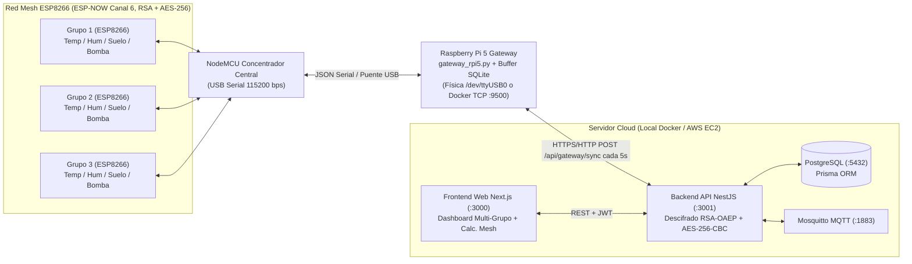

# FloraSense IoT-Grupal — Red Mesh ESP8266 + Gateway Raspberry Pi 5 + Cloud AWS EC2

Plataforma IoT multi-grupo con **comunicación bidireccional** y **seguridad híbrida de extremo a extremo (RSA + AES-256)** diseñada para conectar múltiples nodos **ESP8266 (NodeMCU)** en red Mesh (Canal 6), centralizar su telemetría en un **Concentrador Central** conectado a una **Raspberry Pi 5** (física o simulada en Docker) y sincronizarla de forma segura cada 5 segundos hacia un servidor **AWS EC2** con **NestJS**, **PostgreSQL** y **Next.js**.

---

## Tabla de Contenidos

1. [Arquitectura General](#arquitectura-general)
2. [Flujo Bidireccional de Datos](#flujo-bidireccional-de-datos)
3. [Seguridad y Cifrado](#seguridad-y-cifrado)
4. [Estructura del Repositorio](#estructura-del-repositorio)
5. [Requisitos Previos](#requisitos-previos)
6. [Configuración Segura (Variables de Entorno)](#configuración-segura-variables-de-entorno)
7. [Modos de Ejecución y Despliegue](#modos-de-ejecución-y-despliegue)
   - [Modo A: Prueba real con NodeMCU Concentrador por USB en Windows + RPi 5 Docker](#modo-a-prueba-real-con-nodemcu-concentrador-por-usb-en-windows--rpi-5-docker)
   - [Modo B: Simulación completa de los 3 grupos sin hardware](#modo-b-simulación-completa-de-los-3-grupos-sin-hardware)
   - [Modo C: Despliegue en Producción (Raspberry Pi 5 física + AWS EC2)](#modo-c-despliegue-en-producción-raspberry-pi-5-física--aws-ec2)
8. [Generador Web de Claves RSA y MACs (ESP8266 Mesh)](#generador-web-de-claves-rsa-y-macs-esp8266-mesh)
9. [Referencia de API y Vistas Web](#referencia-de-api-y-vistas-web)
10. [Buenas Prácticas de Seguridad](#buenas-prácticas-de-seguridad)

---

## Arquitectura General



---

## Flujo Bidireccional de Datos

### 1. Uplink (Sensores → Nube)
1. **Nodos ESP8266 (Grupos 1, 2, 3):** Capturan temperatura, humedad ambiental, humedad de suelo y estado de la bomba sumergible, y envían la trama cifrada por ESP-NOW (Canal 6) hacia el **Concentrador Central**.
2. **Concentrador Central:** Descifra/valida la trama de la malla y la emite por puerto serie (`115200 bps`) en formato JSON por línea, por ejemplo:
   ```json
   {"origen":"INVERNADERO_1","temp":24.3,"hum":67.3,"suelo":41.5,"bomba":false,"rssi":-48}
   ```
3. **Raspberry Pi 5 Gateway ([`gateway_rpi5.py`](FloraSense-IoT/gateway/gateway_rpi5.py)):**
   - Almacena localmente cada lectura en un buffer SQLite (`/data/rpi5_local.db` o ruta configurada) para tolerancia a fallos de red.
   - Cada `5 segundos` (`SYNC_INTERVAL_SEC`), agrupa los últimos estados de todos los nodos y **cifra el paquete completo** antes de enviarlo a la API en AWS.
4. **Backend API ([`GatewayService`](FloraSense-IoT/apps/api/src/gateway/gateway.service.ts)):** Descifra el paquete, registra/actualiza automáticamente cada grupo en PostgreSQL, guarda la telemetría histórica y evalúa reglas automáticas de riego.

### 2. Downlink (Web → Bomba / Modo de Riego)
1. Desde el panel web (`http://localhost:3000`), el operador puede cambiar entre modo `AUTO`/`MANUAL` o encender/apagar la bomba de un grupo específico (`POST /api/devices/:id/pump/:action`).
2. La API encola un `PumpCommand` en estado `PENDING`.
3. En el siguiente ciclo de sincronización (`POST /api/gateway/sync`), la API devuelve los comandos pendientes en la respuesta hacia la Raspberry Pi 5.
4. La Raspberry Pi 5 reenvía el comando JSON por serie/TCP al Concentrador:
   ```json
   {"destino":"GRUPO_1","commandId":"...","target":"pump","action":"ON","maxDurationSeconds":30}
   ```
5. El Concentrador transmite la orden al nodo destino y devuelve un `ack`, cerrando el ciclo de trazabilidad en `IrrigationEvent` y `PumpCommand`.

---

## Seguridad y Cifrado

- **Cifrado híbrido Gateway → Cloud:**
  - La API genera o carga un par **RSA-2048** (`AWS_RSA_PUBLIC_KEY` / `AWS_RSA_PRIVATE_KEY`, o autogenerado en runtime en `apps/api/keys/` fuera de Git).
  - La Raspberry Pi 5 obtiene la clave pública vía `GET /api/gateway/public-key`, genera una clave efímera aleatoria **AES-256** por paquete, cifra el JSON con **AES-256-CBC** (PKCS7 + IV aleatorio) y protege la clave AES con **RSA-OAEP (SHA-256)**.
  - Cada petición requiere la cabecera compartida `x-gateway-key` (`GATEWAY_SECRET`).
- **Autenticación de usuarios:** JWT (`HS256`) con `JWT_SECRET` configurable y contraseñas almacenadas con `bcrypt`.
- **Cifrado en malla ESP8266:** Herramienta integrada en `/mesh` ([`MeshCalculatorView.tsx`](FloraSense-IoT/apps/web/src/components/layout/MeshCalculatorView.tsx)) y versión standalone ([`calculadora_rsa_mac_para_red_mesh_nodemcu.html`](calculadora_rsa_mac_para_red_mesh_nodemcu.html)) para generar llaves BearSSL RSA + arreglos MAC C++ por grupo.

---

## Estructura del Repositorio

```text
.
├── docker-compose.yml                         # Orquestación principal (incluye FloraSense + calculadora nginx)
├── bridge_usb_rpi5.ps1                        # Puente USB (Windows COMx) <-> RPi 5 Gateway en Docker (:9500)
├── calculadora_rsa_mac_para_red_mesh_nodemcu.html # Generador standalone de llaves RSA y MACs ESP8266
├── .env.example                               # Plantilla segura de variables de entorno (sin secretos reales)
├── .gitignore                                 # Exclusión de claves privadas, .env, DBs locales y builds
└── FloraSense-IoT/
    ├── docker-compose.yml                     # Servicios: postgres, mosquitto, api, web, rpi5_gateway, simulator
    ├── apps/
    │   ├── api/                               # Backend NestJS + Prisma ORM + Módulo Gateway RSA/AES
    │   └── web/                               # Frontend Next.js (Dashboard multi-grupo, /mesh, historial, reglas)
    ├── gateway/
    │   ├── gateway_rpi5.py                    # Servicio de Raspberry Pi 5 (modos: tcp, serial, mock)
    │   ├── Dockerfile
    │   └── requirements.txt
    ├── firmware/
    │   ├── esp32/                             # Firmware de referencia
    │   └── simulator/                         # Simulador MQTT heredado
    └── infra/
        └── mosquitto/                         # Configuración del broker Mosquitto
```

---

## Requisitos Previos

- **Docker** y **Docker Compose v2**
- **Windows PowerShell** (si se utiliza el puente USB [`bridge_usb_rpi5.ps1`](bridge_usb_rpi5.ps1) hacia Docker)
- **Python 3.11+** (solo si ejecutas `gateway_rpi5.py` directamente fuera de Docker en una Raspberry Pi 5 real)
- **Arduino IDE / PlatformIO** (para cargar el firmware en los ESP8266 / NodeMCU)

---

## Configuración Segura (Variables de Entorno)

Antes de levantar el proyecto en un entorno nuevo o en AWS EC2:

```bash
cp .env.example .env
```

Edita `.env` con tus propias credenciales seguras (nunca subas `.env` ni `apps/api/keys/*.pem` al repositorio):

| Variable | Descripción |
| :--- | :--- |
| `POSTGRES_USER` / `POSTGRES_PASSWORD` | Credenciales de PostgreSQL |
| `JWT_SECRET` | Clave secreta para firmar tokens de sesión Web/API |
| `GATEWAY_SECRET` | Secreto compartido en `x-gateway-key` entre RPi 5 y Backend |
| `ADMIN_EMAIL` / `ADMIN_PASSWORD` | Usuario administrador semilla inicial |
| `RPI_INPUT_MODE` | `tcp` (puente USB Windows), `serial` (RPi 5 física) o `mock` (simulación) |
| `AWS_RSA_PUBLIC_KEY` / `AWS_RSA_PRIVATE_KEY` | (Opcional) Par RSA-2048 fijo en producción |

---

## Modos de Ejecución y Despliegue

### Modo A: Prueba real con NodeMCU Concentrador por USB en Windows + RPi 5 Docker

Ideal cuando todavía no tienes la Raspberry Pi 5 física y conectas el **NodeMCU Concentrador** por USB a tu PC Windows:

1. Levanta la infraestructura y la RPi 5 simulada en modo `tcp`:
   ```powershell
   docker compose --profile sim up -d --build
   ```
2. **Cierra el Monitor Serie de Arduino IDE** para liberar el puerto COM (por ejemplo `COM3`).
3. Inicia el puente bidireccional USB ↔ Docker desde PowerShell o CMD:
   ```powershell
   powershell -ExecutionPolicy Bypass -File .\bridge_usb_rpi5.ps1 -Port COM3 -Baud 115200
   ```
4. Abre **`http://localhost:3000`** en tu navegador. Los grupos activos (`ONLINE`) aparecerán automáticamente arriba en el dashboard.

> Para volver a programar el NodeMCU desde Arduino IDE, detén el puente presionando `Ctrl+C` para liberar el puerto `COM3`.

---

### Modo B: Simulación completa de los 3 grupos sin hardware

Simula 3 grupos de ESP8266 (`GRUPO_1`, `GRUPO_2`, `GRUPO_3`) enviando telemetría y respondiendo comandos de bomba a través de la Raspberry Pi 5 simulada:

```powershell
$env:RPI_INPUT_MODE="mock"
docker compose --profile sim up -d --build
```

En Linux/macOS:
```bash
RPI_INPUT_MODE=mock docker compose --profile sim up -d --build
```

---

### Modo C: Despliegue en Producción (Raspberry Pi 5 física + AWS EC2)

#### 1. En el servidor AWS EC2 (Cloud)
1. Clona el repositorio y crea `.env` con secretos fuertes (`JWT_SECRET`, `GATEWAY_SECRET`, `POSTGRES_PASSWORD`, `ADMIN_PASSWORD`).
2. Ajusta `NEXT_PUBLIC_API_URL` apuntando a la IP pública o dominio de tu EC2 (por ejemplo `http://TU_IP_PUBLICA_EC2:3001/api/v1`) y abre los puertos necesarios en el Security Group (`3000` Web, `3001` API).
3. Inicia los servicios principales (sin el gateway simulado):
   ```bash
   docker compose up -d --build postgres mosquitto api web
   ```

#### 2. En la Raspberry Pi 5 física (Gateway en campo)
1. Conecta el **NodeMCU Concentrador** a un puerto USB de la Raspberry Pi 5 (normalmente `/dev/ttyUSB0` o `/dev/ttyACM0`).
2. Instala las dependencias Python del gateway:
   ```bash
   cd FloraSense-IoT/gateway
   python3 -m venv .venv
   source .venv/bin/activate
   pip install -r requirements.txt
   ```
3. Ejecuta el gateway apuntando a tu servidor EC2 en AWS:
   ```bash
   export INPUT_MODE=serial
   export SERIAL_PORT=/dev/ttyUSB0
   export SERIAL_BAUD=115200
   export AWS_API_URL=http://TU_IP_PUBLICA_EC2:3001
   export GATEWAY_SECRET=el-mismo-secreto-de-tu-ec2
   export LOCAL_DB_PATH=./rpi5_local.db
   python3 gateway_rpi5.py
   ```

---

## Generador Web de Claves RSA y MACs (ESP8266 Mesh)

El sistema incluye una calculadora visual para configurar las claves BearSSL RSA y las direcciones MAC de los 3 grupos + Concentrador:

- **Integrada en la plataforma:** [`http://localhost:3000/mesh`](http://localhost:3000/mesh)
- **Standalone en Docker (Nginx):** [`http://localhost:8080`](http://localhost:8080)

Genera el código C++ listo para pegar en cada ESP8266 (`uint8_t macConcentrador[]`, `uint8_t macGrupo1..3[]`, `struct MensajeMesh`, clave pública del receptor y clave privada local).

---

## Referencia de API y Vistas Web

### Endpoints principales (Backend `:3001`)
| Método | Ruta | Autenticación | Descripción |
| :--- | :--- | :--- | :--- |
| `POST` | `/api/auth/login` | Pública | Inicio de sesión y obtención de JWT |
| `GET` | `/api/devices/overview` | Bearer JWT | Resumen en tiempo real de todos los grupos (`ONLINE` primero) |
| `POST` | `/api/devices/:id/pump/:action` | Bearer JWT | Encola comando bidireccional (`on` / `off`) para la bomba |
| `PATCH` | `/api/devices/:id/mode` | Bearer JWT | Alterna entre modo `AUTO` y `MANUAL` |
| `GET` | `/api/gateway/public-key` | Pública | Clave pública RSA-2048 del servidor para cifrar paquetes |
| `GET` | `/api/gateway/status` | Pública | Estado de conexión y conteo de sincronizaciones RSA+AES |
| `POST` | `/api/gateway/sync` | `x-gateway-key` | Recibe telemetría/ACKs cifrados y retorna comandos `PENDING` |

### Vistas Web (Frontend `:3000`)
- `/` — Panel multi-grupo en tiempo real, estado de Gateway RPi 5 y control individual de bombas
- `/mesh` — Calculadora centralizada de claves RSA y MACs para ESP8266
- `/history` — Historial de lecturas y eventos de riego por grupo
- `/rules` — Reglas automáticas de humedad por dispositivo
- `/policies` — Políticas de seguridad IoT
- `/settings` — Configuración de cuenta y firmware

---

## Buenas Prácticas de Seguridad

- **Nunca subas a Git:** archivos `.env`, llaves privadas (`*.pem`, `*.key`, `apps/api/keys/`), ni bases de datos locales (`*.db`, `*.sqlite`).
- **Usa HTTPS en AWS EC2:** coloca un proxy inverso (Nginx / Caddy + TLS) delante de los puertos `3000` y `3001` para proteger las cabeceras JWT y `x-gateway-key` en tránsito.
- **Protege la alimentación eléctrica del hardware:** alimenta las bombas sumergibles con fuente externa y módulo relé/optoacoplador, nunca directamente desde el puerto USB de la PC o Raspberry Pi.
